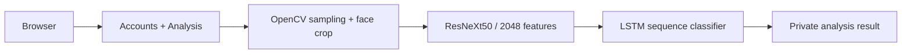

# VeritasAI

VeritasAI is a Django application for video deepfake research. The initial release implements the required **ResNeXt50 feature extractor + ordered LSTM classifier** and deliberately refuses to produce a detection result until a valid trained checkpoint is configured.

## Architecture



See [docs/architecture.md](docs/architecture.md), [docs/ml_pipeline.md](docs/ml_pipeline.md), and [docs/dataset_guide.md](docs/dataset_guide.md).

## Local setup (Mac / Apple Silicon)

Python 3.9+ is supported. Create an environment and install dependencies:

```bash
python3 -m venv .venv
source .venv/bin/activate
pip install -r requirements.txt
cp .env.example .env
python manage.py migrate
python manage.py check
python manage.py runserver
```

PyTorch selects Apple MPS when available and otherwise CPU. No CUDA packages are required. The first use of ImageNet weights may download a large model; set `USE_IMAGENET_WEIGHTS=False` when offline. A random/untrained backbone is never presented as a verified detector.

## Training

Do not commit datasets or checkpoints. Create a CSV manifest with columns `video_path,label,group`, where label is `0` for REAL and `1` for FAKE. `group` should identify a person/source so splits can be made by identity rather than frame. Then:

```bash
mkdir -p checkpoints
python -m ml.train --manifest data/manifest.csv --output checkpoints/resnext50-lstm.pt --epochs 10 --frames 20
```

Set `MODEL_CHECKPOINT_PATH=/absolute/path/checkpoints/resnext50-lstm.pt` in `.env`, restart Django, and run evaluation:

```bash
python -m ml.evaluate --manifest data/test.csv --checkpoint checkpoints/resnext50-lstm.pt
```

## Diagnostic without a trained checkpoint

To verify a real video through preprocessing, OpenCV decoding, face detection,
ImageNet-weighted ResNeXt50, and the LSTM without producing a REAL/FAKE result:

```bash
python scripts/diagnose_pipeline.py media/uploads/<date>/<file>.mp4 --frames 20 --device auto
```

The diagnostic prints decoded frame indices, face coverage, feature shape,
LSTM input/output shapes, and an explicit statement that no trained model was
used.

Training fails clearly when the manifest is missing, empty, unlabelled, or points to missing videos. It does not invent data or metrics.

## Security and limitations

Uploads are authenticated, CSRF-protected, size/extension/MIME validated, stored with generated Django paths, and analysis history is scoped to the owner. This is a research aid, not proof of authenticity: errors are possible under compression, unseen manipulation methods, multiple faces, and distribution shift. The UI displays this limitation and blocks inference without a real checkpoint.
