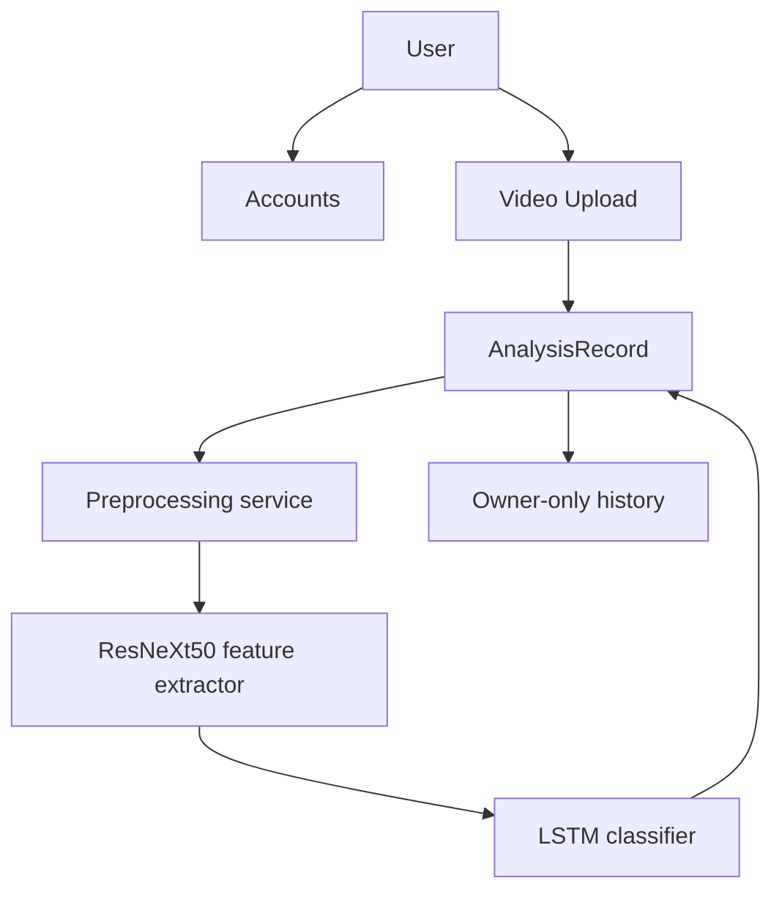

# Architecture

`accounts` owns registration/login. `analysis` owns records, upload validation, owner checks, and views. `ml` is framework-independent and contains preprocessing, model construction, checkpoint loading, training, evaluation, and metrics. SQLite is the development database; media files are kept outside source control.

